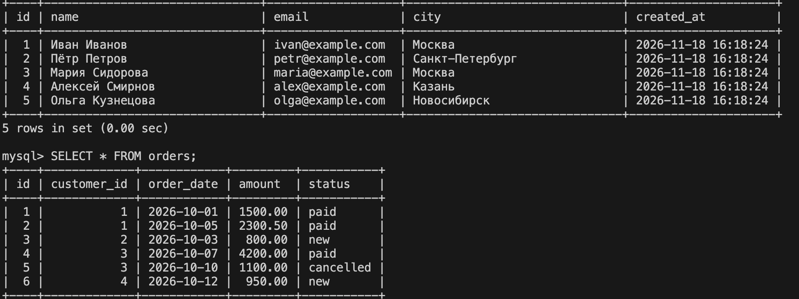
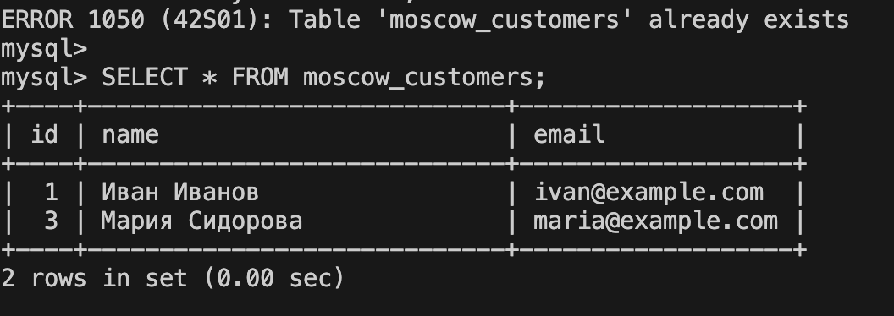
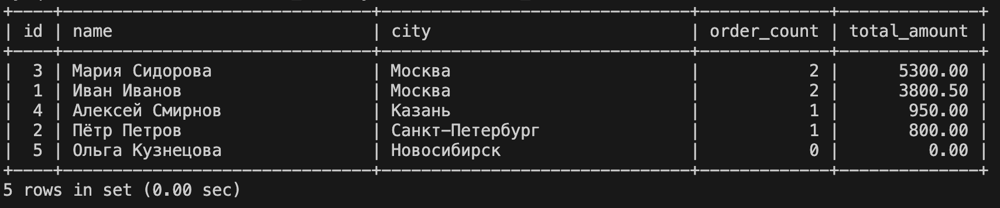
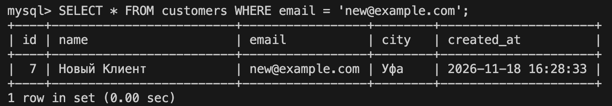
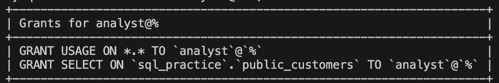

# 🗄️ Отчёт: Представления (VIEW) в MySQL


> **Дисциплина:** Основы проектирования баз данных
> **Задание:** Изучение механизма представлений (VIEW) в MySQL
> **Дата:** ноябрь 2026

---

## 📑 Содержание

1. [Цель работы](#-цель-работы)
2. [Среда выполнения](#-среда-выполнения)
3. [Структура проекта](#-структура-проекта)
4. [Ход выполнения](#-ход-выполнения)
   - [Шаг 1. Создание БД и таблиц](#шаг-1-создание-бд-и-таблиц)
   - [Шаг 2. Простое представление (VIEW)](#шаг-2-простое-представление-view)
   - [Шаг 3. VIEW с JOIN и агрегацией](#шаг-3-view-с-join-и-агрегацией)
   - [Шаг 4. Обновляемое VIEW](#шаг-4-обновляемое-view)
   - [Шаг 5. Необновляемое VIEW](#шаг-5-необновляемое-view)
   - [Шаг 6. WITH CHECK OPTION](#шаг-6-with-check-option)
   - [Шаг 7. Права доступа через VIEW](#шаг-7-права-доступа-через-view)
   - [Шаг 8. Дамп и логи](#шаг-8-дамп-и-логи)
5. [Сводная таблица](#-сводная-таблица)
6. [Вывод](#-вывод)

---

## 🎯 Цель работы

Освоить работу с представлениями (VIEW) в MySQL: создание, использование, обновление и удаление. Научиться настраивать права доступа через VIEW, а также использовать опцию `WITH CHECK OPTION` для защиты от некорректных вставок.

---

## 🛠 Среда выполнения

| Компонент | Версия / Значение |
|-----------|-------------------|
| ОС | macOS (Apple Silicon) |
| Терминал | zsh |
| Docker | Docker Desktop |
| Образ MySQL | `mysql:8.0` → **MySQL Community Server 8.0.46** |
| Кодировка | `utf8mb4` / `utf8mb4_unicode_ci` |
| Клиент | `mysql` CLI внутри контейнера |

---

## 📁 Структура проекта

```text
my-mysql/
├── 📄 my.cnf          # конфиг MySQL (utf8mb4 + general_log)
├── 💾 dump.sql        # дамп БД sql_practice
├── 📝 my_actions.log  # лог только SQL-команд (отфильтрованный)
├── 📘 README.md       # этот отчёт
└── 📸 screenshots/    # скриншоты результатов
    ├── 01-db-tables.png
    ├── 02-simple-view.png
    ├── 03-view-join.png
    ├── 04-view-update.png
    ├── 05-view-check-option.png
    └── 06-view-grants.png
```

---

## 🚀 Ход выполнения

### Шаг 1. Создание БД и таблиц

```sql
CREATE DATABASE sql_practice
  CHARACTER SET utf8mb4
  COLLATE utf8mb4_unicode_ci;
USE sql_practice;

CREATE TABLE customers (
    id INT AUTO_INCREMENT PRIMARY KEY,
    name VARCHAR(100) NOT NULL,
    email VARCHAR(100) NOT NULL UNIQUE,
    city VARCHAR(100),
    created_at TIMESTAMP DEFAULT CURRENT_TIMESTAMP
) CHARACTER SET utf8mb4 COLLATE utf8mb4_unicode_ci;

CREATE TABLE orders (
    id INT AUTO_INCREMENT PRIMARY KEY,
    customer_id INT NOT NULL,
    order_date DATE NOT NULL,
    amount DECIMAL(10, 2) NOT NULL,
    status VARCHAR(20) DEFAULT 'new',
    FOREIGN KEY (customer_id) REFERENCES customers(id)
) CHARACTER SET utf8mb4 COLLATE utf8mb4_unicode_ci;
```

Заполнено 5 клиентов и 6 заказов.



---

### Шаг 2. Простое представление (VIEW)

**Задача:** создать представление для фильтрации клиентов из Москвы.

```sql
CREATE VIEW moscow_customers AS
SELECT id, name, email
FROM customers
WHERE city = 'Москва';

SELECT * FROM moscow_customers;
```



> **Важно:** VIEW не хранит данные. При добавлении нового клиента из Москвы в таблицу `customers`, он сразу появляется в `moscow_customers`.

---

### Шаг 3. VIEW с JOIN и агрегацией

**Задача:** создать сводку по клиентам (количество заказов и общая сумма).

```sql
CREATE VIEW customer_summary AS
SELECT c.id,
       c.name,
       c.city,
       COUNT(o.id)              AS order_count,
       COALESCE(SUM(o.amount), 0) AS total_amount
FROM customers c
LEFT JOIN orders o ON c.id = o.customer_id
GROUP BY c.id, c.name, c.city;

SELECT * FROM customer_summary ORDER BY total_amount DESC;
```



---

### Шаг 4. Обновляемое VIEW

**Задача:** доказать, что VIEW на основе одной таблицы можно обновлять.

```sql
CREATE VIEW active_customers AS
SELECT id, name, email, city
FROM customers
WHERE city IS NOT NULL;
```

**Тест UPDATE:**
```sql
UPDATE active_customers SET city = 'Сочи' WHERE id = 2;
SELECT * FROM customers WHERE id = 2; -- Изменения применились к базовой таблице
```

**Тест INSERT и DELETE:**
```sql
INSERT INTO active_customers (name, email, city) VALUES ('Новый Клиент', 'new@example.com', 'Уфа');
DELETE FROM active_customers WHERE email = 'new@example.com';
```



---

### Шаг 5. Необновляемое VIEW

**Задача:** показать, что VIEW с агрегатами нельзя обновлять.

```sql
UPDATE customer_summary SET name = 'X' WHERE id = 1;
```

**Результат:**
```text
ERROR 1288 (HY000): The target table customer_summary of the UPDATE is not updatable
```
MySQL не может разложить агрегат `COUNT` обратно на строки базовой таблицы.

---

### Шаг 6. WITH CHECK OPTION

**Задача:** защитить VIEW от вставки строк, не соответствующих условию `WHERE`.

```sql
CREATE OR REPLACE VIEW moscow_customers AS
SELECT id, name, email, city
FROM customers
WHERE city = 'Москва'
WITH CHECK OPTION;

INSERT INTO moscow_customers (name, email, city)
VALUES ('Пётр Третий', 'petr3@example.com', 'Казань');
```

**Результат:**
```text
ERROR 1369 (HY000): CHECK OPTION failed 'sql_practice.moscow_customers'
```


---

### Шаг 7. Права доступа через VIEW

**Задача:** скрыть столбец `email` от пользователя `analyst`.

```sql
CREATE VIEW public_customers AS
SELECT id, name, city FROM customers;

CREATE USER 'analyst'@'%' IDENTIFIED BY 'pass';
GRANT SELECT ON sql_practice.public_customers TO 'analyst'@'%';

SHOW GRANTS FOR 'analyst'@'%';
```



---

### Шаг 8. Дамп и логи

**Создание дампа БД:**
```bash
docker exec -e MYSQL_PWD=123 my-mysql mysqldump -uroot sql_practice > dump.sql
```

**Создание лога действий:**
```bash
docker exec my-mysql cat /var/lib/mysql/general.log \
  | grep "Query" \
  | grep -v -E "SET NAMES|SET autocommit|SET sql_mode|SET character_set_results|SHOW VARIABLES|SHOW STATUS|SHOW WARNINGS|SELECT @@|SELECT DATABASE\(\)|time_zone" \
  > my_actions.log
```

---

## 📊 Сводная таблица

| Действие | Команда | Результат |
|----------|---------|-----------|
| Создать простое VIEW | `CREATE VIEW ... AS SELECT ...` | Готово |
| Создать VIEW с JOIN | `CREATE VIEW ... AS SELECT ... JOIN ...` | Готово |
| Обновить через VIEW | `UPDATE view_name SET ...` | `Query OK` |
| Обновить агрегатное VIEW | `UPDATE customer_summary ...` | `ERROR 1288` |
| Защита от вставки | `... WITH CHECK OPTION` | `ERROR 1369` |
| Дать права на VIEW | `GRANT SELECT ON ... TO ...` | `Query OK` |

---

## ✅ Вывод

В ходе работы:

1. ✅ Создана БД `sql_practice` с таблицами `customers` и `orders` (с внешним ключом).
2. ✅ Освоено создание **простых VIEW** и **VIEW с JOIN и агрегацией**.
3. ✅ Проверено, что VIEW — это **живой запрос** (изменения в таблицах сразу видны).
4. ✅ Изучены **обновляемые** и **необновляемые** VIEW.
5. ✅ Проверен механизм `WITH CHECK OPTION`.
6. ✅ Настроены **права доступа** через VIEW (скрытие столбца `email`).
7. ✅ Создан дамп БД и лог действий (`my_actions.log`).

**Ключевой вывод:** VIEW — это сохранённый SQL-запрос, который выглядит как таблица, но не хранит данные. Он удобен для абстракции, скрытия структуры и разграничения прав, но не ускоряет запросы.

---

## 📎 Приложения

- 📄 [Лог SQL-команд](my_actions.log)
- 💾 [Дамп БД `sql_practice`](dump.sql)
- ⚙️ [Конфиг MySQL](my.cnf)

---

<div align="center">
  <i>© 2026</i>
</div>
